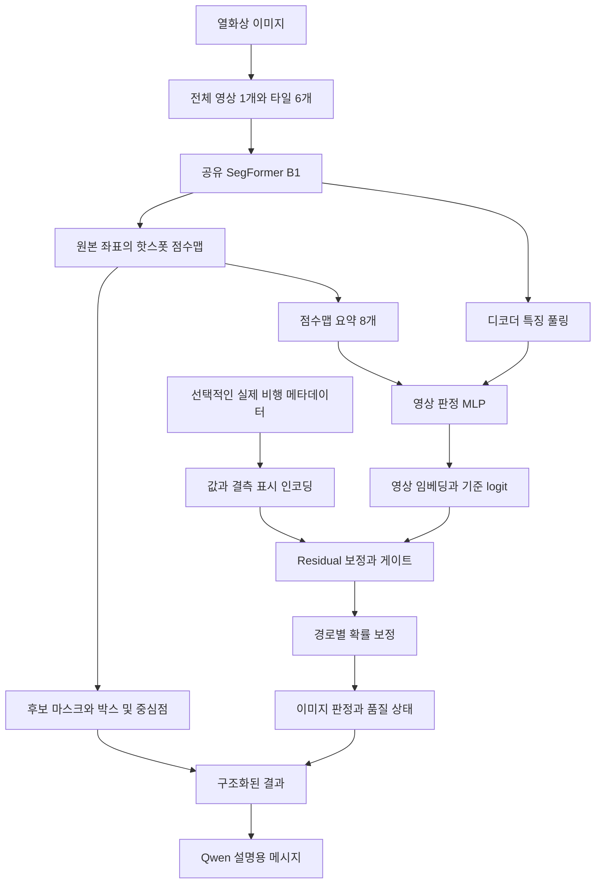

# 태양광 열화상 핫스폿 분석 모델

드론으로 촬영한 태양광 열화상에서 **핫스폿 후보의 위치**를 찾고, 추가 학습을 통해 **이미지에 핫스폿이 하나 이상 존재할 확률**을 계산하는 PyTorch 프로젝트입니다.

SegFormer가 픽셀별 분할을 수행하고, 영상 판정 모델이 이미지 단위 판단을 수행합니다. 실제 비행 메타데이터를 확보하면 Residual 결합부가 영상 판정을 보정합니다. Qwen에는 수치와 위치를 구조화해 전달하며, 현재 구현은 **설명용 메시지 생성까지** 제공합니다. 실제 Qwen 실행이나 API 호출은 포함하지 않습니다.

**현재 우선 사용 범위는 비행 메타데이터 없는 SegFormer 단독 학습과 추론입니다.** 아래의 빠른 시작은 이 경우를 기준으로 합니다.

## 실행 모드와 출력의 의미

| 모드 | 입력 | 필요한 학습 | 제공하는 결과 |
|---|---|---|---|
| SegFormer 단독 | 열화상 이미지 | `seg` | 픽셀 점수맵, 후보 마스크, 박스, 중심점, 면적 |
| 영상 판정 | 열화상 이미지 | `seg` → `image` | 위치와 이미지 단위 이상 점수 또는 보정 확률 |
| 메타데이터 결합 | 열화상과 연결된 실제 비행 정보 | `seg` → `image` → `fusion` | 위치와 촬영 조건을 고려한 이미지 판정 |
| 설명 | 구조화된 분석 결과 | 별도 Qwen 연결 필요 | 수치와 좌표를 설명하는 자연어 보고서 |

- **픽셀 점수**는 특정 픽셀이 핫스폿에 속한다고 예측한 값입니다.
- **영역 평균 점수**는 후보 마스크 안의 픽셀 점수 평균이며, 개별 결함의 보정 확률이 아닙니다.
- **이미지 단위 확률**의 예측 대상은 한 장에 핫스폿이 하나 이상 존재하는 사건입니다. 영상 판정 학습과 별도 확률 검증이 필요합니다.
- **위치**는 원본 이미지의 픽셀 좌표입니다. GPS 위치나 실제 면적은 계산하지 않습니다.

SegFormer만 학습했다면 이미지 단위 확률은 `null`로 출력합니다. 후보가 없다는 결과를 패널의 전기적 정상 상태로 확정하지 않습니다.

## 전체 모델 구조



SegFormer 단독 모드는 점수맵과 위치 결과만 사용합니다. 메타데이터는 이미지 판정의 logit을 보정하며, 분할 마스크의 위치를 직접 수정하지 않습니다.

확장성을 유지하는 연결 지점은 **결과 스키마**입니다. 센서나 모델을 추가해도 확률, 위치, 입력 품질과 버전 정보를 같은 형식으로 전달할 수 있습니다. 새 센서를 판정에 활용하려면 해당 인코더와 결합 모델의 재학습 및 실측 검증이 필요합니다.

## 빠른 시작 SegFormer 단독 실행

다음은 프로젝트를 설치한 **Linux 서버**에서 실행하는 예시입니다. Python 3.11 이상과 서버 환경에 맞는 GPU용 PyTorch를 먼저 준비하세요. CPU를 사용하면 `--device cuda`를 `--device cpu`로 변경합니다.

```bash
python3 -m venv .venv
source .venv/bin/activate
python -m pip install --upgrade pip
# 서버 드라이버에 맞는 GPU용 PyTorch를 설치한 다음 실행
python -m pip install -e '.[test]'
python -c "import torch; print(torch.__version__); print(torch.cuda.is_available())"
```

GPU 학습 전 마지막 출력이 `True`인지 확인하세요. `requirements-tested.txt`는 로컬 CPU 버전 기록이며 서버 CUDA 설치 지침이 아닙니다.

### 이미지와 라벨 준비

```text
/data/solar/
├── images/
│   ├── Positive/PanelFront/example.jpg
│   └── Normal/PanelFront/normal.jpg
└── labels/
    ├── Positive/PanelFront/example.json
    └── Normal/PanelFront/normal.json
```

폴더 배치는 예시입니다. JSON의 `image.filename`으로 이미지를 연결하므로 해당 파일이 image root 아래에 정확히 한 개 있어야 합니다. 같은 이름의 이미지가 여러 개 발견되면 중단합니다.

```bash
python -m solar_hotspot prepare \
  --label-root /data/solar/labels \
  --image-root /data/solar/images \
  --output data/all.jsonl

python -m solar_hotspot inspect --manifest data/all.jsonl
```

생성된 manifest의 `group_id`를 검토해 `data/seg_train.jsonl`과 `data/val.jsonl`로 분리합니다. `prepare`는 분할을 자동 수행하지 않습니다. 같은 패널·비행의 중복 장면이 학습과 검증에 나뉘지 않도록 합니다. Windows의 `C:/...` 경로는 Linux에서 사용할 수 없으므로 서버에서 manifest를 다시 만드세요.

### 학습

```bash
export HF_HOME="$PWD/artifacts/hf"
python -m solar_hotspot train --stage seg \
  --train data/seg_train.jsonl --val data/val.jsonl \
  --output runs/seg --backbone b1 \
  --pretrained nvidia/segformer-b1-finetuned-ade-512-512 \
  --epochs 30 --patience 5 --batch-size 1 --workers 2 \
  --device cuda
```

사전학습 이름 대신 로컬 모델 디렉터리를 지정할 수도 있습니다. 최초 원격 가중치 다운로드가 필요할 수 있습니다. 30 epoch는 상한이며 조기 종료될 수 있습니다. 실제 성능 학습에 `--smoke`는 사용하지 않습니다.

학습 출력은 `runs/seg/best.pt`와 epoch별 기록인 `runs/seg/metrics.jsonl`입니다.

### 라벨 없는 이미지 추론

**기본 `solar_hotspot predict`는 영상 판정기까지 학습한 checkpoint를 요구합니다.** SegFormer만 학습했다면 전용 예제를 사용합니다.

```bash
python -m scripts.segmentation_example \
  --checkpoint runs/seg/best.pt \
  --image /data/solar/new/thermal.jpg \
  --output runs/seg_prediction \
  --threshold 0.5 --device cuda
```

프로젝트 루트에서 실행합니다. 추론에는 이미지 한 장만 필요하며 라벨 JSON이나 비행 로그는 필요하지 않습니다. checkpoint에 저장된 타일 설정을 사용합니다. 예제는 공통 모델을 호출하지만 미학습 판정 헤드의 점수는 사용하지 않습니다.

| 추론 출력 | 형식과 의미 |
|---|---|
| `probability.npy` | 원본 크기 `[H,W]`의 float32 핫스폿 점수맵 |
| `mask.png` | 원본 크기, 후보 픽셀 255와 배경 0 |
| `overlay.png` | 후보 영역을 붉게 중첩한 원본 영상 |
| `result.json` | 후보 좌표, 면적, 점수, 모드와 checkpoint 정보 |
| `qwen_messages.json` | Qwen 설명 메시지. 외부 호출은 하지 않음 |

다음은 형식 설명용 출력 예시이며 실제 추론 결과는 아닙니다. 실제 파일에는 파일 참조와 provenance 및 limitations도 포함합니다.

```json
{
  "mode": "segmentation_only",
  "prediction": {
    "image_hotspot_probability": null,
    "final_probability": null,
    "calibrated": false,
    "candidate_detected": true
  },
  "localization": {
    "coordinate_system": "image_pixels",
    "image_size": [640, 512],
    "segmentation_threshold": 0.5,
    "regions": [
      {
        "bbox_xywh": [564, 177, 13, 23],
        "centroid_xy": [570.0, 188.0],
        "area_px": 175,
        "mean_segmentation_score": 0.87
      }
    ]
  }
}
```

원점은 이미지 왼쪽 위이고 x는 오른쪽, y는 아래로 증가합니다. `bbox_xywh`는 `[x,y,너비,높이]`, 중심점은 후보 마스크 픽셀 좌표의 산술 평균입니다. `area_px`는 픽셀 수이며 실제 면적이 아닙니다. 임계값 0.5는 시작 예시이므로 운영 값은 별도 검증에서 선택합니다.

SegFormer 단독 평가에서는 Dice와 IoU를 확인하세요. 공통 평가 코드가 계산하는 이미지 recall, Brier 등은 미학습 판정 헤드의 값이므로 해석하지 않습니다. 평가 결과의 `image_classifier_trained=false`를 확인합니다.

## 구현 모듈

| 파일 | 기능 |
|---|---|
| `solar_hotspot/data.py` | 현재 JSON 스키마, 다각형 마스크, 이미지 매칭, manifest, 그룹 누출 검사 |
| `solar_hotspot/metadata.py` | 16차원 값·결측 표시, 각도 변환, 학습 데이터에서만 scaler 계산 |
| `solar_hotspot/views.py` | 전체 영상·타일, 유효 영역, 원본 좌표 확률맵 병합 |
| `solar_hotspot/model.py` | SegFormer 특징 추출, 영상 판정, gated Residual 결합 |
| `solar_hotspot/losses.py` | 분할·판정·Residual loss |
| `solar_hotspot/engine.py` | 단계별 동결·학습, 검증, checkpoint, 확률 보정 |
| `solar_hotspot/inference.py` | 영역·박스·중심점, Qwen용 결과 스키마 |
| `solar_hotspot/reporting.py` | 수치를 보존하는 Qwen 입력 메시지 |
| `solar_hotspot/cli.py` | 준비·검사·학습·보정·평가·추론 명령 |
| `scripts/segmentation_example.py` | SegFormer 단독 checkpoint의 점수맵·위치 출력 |
| `tests/` | 데이터 오류, gradient, fallback, 좌표, 단계 학습 통합 테스트 |

## 설치

Python 3.11 이상을 사용합니다. 작업 폴더에 생성된 `.venv`에는 실행 검증용 CPU 의존성이 설치되어 있습니다.

```powershell
python -m venv .venv
.\.venv\Scripts\python.exe -m pip install -e ".[test]"
.\.venv\Scripts\python.exe -m pytest -q
```

검증 당시의 정확한 의존성은 `requirements-tested.txt`에 있습니다. CUDA 학습은 해당 환경에 맞는 PyTorch를 설치하고 `--device cuda`를 지정하세요. CPU smoke 검증은 CUDA 검증을 대신하지 않습니다.

## 1. 현재 이미지·JSON 색인

label root는 SolarPanel 디렉터리로 제한합니다. 다른 설비의 라벨을 섞으면 지원하지 않는 클래스로 중단합니다.

```powershell
.\.venv\Scripts\python.exe -m solar_hotspot prepare `
  --label-root "C:/Users/samsung/Downloads/Sample (1)/Sample/02.라벨링데이터/SolarPanel" `
  --image-root "C:/Users/samsung/Downloads/Sample (1)/Sample/01.원천데이터/SolarPanel" `
  --output artifacts/sample_manifest.jsonl

.\.venv\Scripts\python.exe -m solar_hotspot inspect --manifest artifacts/sample_manifest.jsonl
```

원본은 수정하지 않습니다. 이미지 파일명의 중복·누락, 이미지/라벨 크기 불일치, 잘못된 다각형, 정상/이상 정답 충돌은 오류로 처리합니다. 정상은 `NormalDB` 또는 QA의 명시적인 정상 정답을 확인한 경우에만 빈 마스크로 변환합니다. `annotations` 누락을 무조건 정상으로 해석하지 않습니다.

현재 샘플은 **19쌍: 이상 3장, 정상 16장, 핫스폿 주석 26개, 지역·날짜 기준 2개 그룹**입니다. 너비·높이가 모두 10픽셀 미만인 박스 주석은 17개입니다. 비행 메타데이터는 없습니다. 이 데이터로 전체 단계의 독립적인 학습·보정·시험 성능을 확보했다고 주장할 수 없습니다.

## 2. Manifest와 메타데이터 연결

Manifest는 한 줄에 이미지 하나를 기록한 UTF-8 JSONL입니다. 경로는 절대 경로 또는 manifest 기준 상대 경로를 지원합니다.

```json
{"image_id":"118506","image_path":"images/example.jpg","label_path":"labels/example.json","group_id":"siteA-flight001","metadata":{},"synthetic":false}
```

실제 로그를 이미지 촬영 시각과 동기화한 뒤 `metadata`에 다음 키를 기록합니다. 빈 값은 `null` 또는 키 생략으로 표현하세요. `examples/metadata.json`은 값이 없는 입력 템플릿입니다.

| 키 | 단위·의미 |
|---|---|
| `height_agl_m` | 지면 기준 높이, m. 해발고도와 구분 |
| `horizontal_speed_mps`, `vertical_speed_mps` | m/s, 수직 속도 부호 기준은 데이터 전체에서 통일 |
| `roll_deg`, `pitch_deg`, `yaw_deg` | 드론 자세, degree |
| `gimbal_pitch_deg`, `gimbal_yaw_deg` | 짐벌 자세, degree. 좌표계 명시 필요 |
| `local_time_seconds` | 시간대가 확인된 현지 시각의 자정 이후 초, `[0,86400)` |
| `exposure_ms` | 노출 시간, ms |
| `synchronized` | `false`이면 해당 행 전체를 무효 처리 |

각도 5개를 sin/cos 10개로, 시각을 sin/cos 2개로 바꿔 총 16개 값이 됩니다. 유효성 표시 16개를 연결해 `[B,32]`를 만듭니다. 수치·시간 필드는 JSON의 설명문에서 추측하지 않습니다. 원본 로그의 보간, 시간 오프셋 추정, 좌표계 변환은 이 코드의 범위 밖이며 연결된 행을 입력받습니다.

초기 checkpoint에는 seg 학습 분할에서 적합한 scaler가 저장되며, 실제 fusion 학습을 시작할 때 fusion 학습 분할로 다시 적합합니다. 검증·시험·추론에서는 저장된 통계만 사용합니다. 학습 중 한 번도 관측되지 않은 필드는 추론에서 값이 들어와도 사용하지 않습니다. 새 필드를 활용하려면 scaler와 fusion을 다시 학습해야 합니다.

### 메타데이터 JSON 예시와 결측 처리

학습 시에는 manifest의 `metadata` 안에 넣습니다. 단일 이미지 추론에서는 아래 객체 자체를 별도 JSON으로 저장해 `--metadata-json`으로 전달합니다. 기존 라벨 JSON 안에 값을 추가하는 것만으로는 현재 코드가 읽지 않습니다.

```json
{
  "synchronized": true,
  "height_agl_m": 25.0,
  "horizontal_speed_mps": null,
  "vertical_speed_mps": null,
  "roll_deg": 1.5,
  "pitch_deg": null,
  "yaw_deg": null,
  "gimbal_pitch_deg": -90.0,
  "gimbal_yaw_deg": null,
  "local_time_seconds": 47403,
  "exposure_ms": null
}
```

숫자는 형식 예시입니다. 실제 이미지에 임의로 부여하지 않습니다.

| 상황 | 현재 처리 |
|---|---|
| 키 생략 또는 `null` | 정규화 공간에서 값 0, 유효성 0 |
| 각도 또는 시각 누락 | 대응하는 sin/cos 두 특징 모두 결측 |
| 일부 특징만 존재 | 유효한 특징과 결측 표시를 함께 사용 |
| 전부 없음 또는 `synchronized: false` | 보정 0, 영상 경로 사용 |
| `synchronized` 생략 | 호출 측에서 이미 연결을 검증한 입력으로 간주 |
| 학습 중 미관측인 특징이 추론에 등장 | 해당 특징을 사용하지 않음 |
| 비유한 숫자 | 결측 처리. JSON에서는 `null` 권장 |
| 숫자로 변환할 수 없는 문자열 | 오류 |
| 고도·수평 속도·노출 시간의 음수 | 오류 |
| 촬영 시각 범위 초과 | 오류 |
| 정의하지 않은 추가 필드 | 무시 |

각도·시각 변환 후 16개 값 모두를 학습 통계로 정규화합니다. 표준편차가 거의 0이면 나누는 값을 1로 사용합니다. 일부 특징만 존재하는 경우에는 유효한 특징 하나만 있어도 게이트가 활성화될 수 있습니다. 전체 결측의 계산적 fallback과 부분 결측에서의 실제 성능은 구분해서 검증해야 합니다.

## 3. 분할과 학습 순서

`prepare`는 안전하지 않은 무작위 이미지 분할을 하지 않습니다. 자동 `group_id`는 지역+날짜이며 **검토용 초기값**입니다. 같은 패널을 여러 날짜에 반복 촬영했다면 그룹을 합쳐야 합니다. 같은 비행·동일 패널·중복 프레임이 분할을 넘지 않도록 다음 manifest를 마련합니다.

- `seg_train.jsonl`: 분할기 학습
- `image_train.jsonl`: 앞선 분할기가 학습하지 않은 그룹의 영상 판정 학습
- `fusion_train.jsonl`: 앞선 모델들이 학습하지 않은 그룹의 실측 메타데이터 결합 학습
- `val.jsonl`: 모델 선택, 임계값 선정
- `calibration.jsonl`: 확률 보정
- `test.jsonl`: 최종 독립 시험

이 구현은 단순하고 엄격한 **단계별 독립 학습 그룹** 방식을 사용합니다. Out-of-fold 캐시 기반 cross-fitting은 구현하지 않았습니다. 데이터가 적으면 교차적합 파이프라인을 별도로 마련해야 하며 `group_id`를 임의 변경해 검사를 우회하면 안 됩니다. 학습·검증·보정·시험 간 그룹/이미지 ID/파일 경로 중복을 검사합니다. 파일을 복사·이름 변경한 중복은 자동 탐지하지 않으므로 그룹 검토가 필요합니다.

SegFormer와 영상 판정 모델에 서로 다른 종류의 이미지가 필요한 것은 아닙니다. 판정 모델은 같은 열화상의 SegFormer 예측 특징을 입력으로 받습니다. 단계별 그룹 분리는 앞 모델의 학습 데이터 예측에 후속 모델이 의존하는 것을 줄이기 위한 현재 구현 정책입니다. 같은 학습 이미지로 공동 학습하는 구성도 가능하지만 최종 검증·시험은 독립적으로 유지해야 합니다. 현재 `joint` 명령은 앞 단계 학습 완료를 요구합니다.

### A. SegFormer

사전학습 이름 또는 로컬 모델 디렉터리를 사용합니다. 최초 원격 가중치 다운로드가 필요할 수 있습니다. 이 작업에서 사전학습 가중치 다운로드·전체 성능 학습은 수행하지 않았습니다.

```powershell
$env:HF_HOME = "$PWD/artifacts/hf"
.\.venv\Scripts\python.exe -m solar_hotspot train --stage seg `
  --train data/seg_train.jsonl --val data/val.jsonl --output runs/seg `
  --backbone b1 --pretrained nvidia/segformer-b1-finetuned-ade-512-512 `
  --epochs 30 --patience 5 --batch-size 1 --device cuda
```

### B. 영상 판정

```powershell
.\.venv\Scripts\python.exe -m solar_hotspot train --stage image `
  --train data/image_train.jsonl --val data/val.jsonl `
  --init runs/seg/best.pt --output runs/image --epochs 5 --device cuda
```

### C. Residual 결합

```powershell
.\.venv\Scripts\python.exe -m solar_hotspot train --stage fusion `
  --train data/fusion_train.jsonl --val data/val.jsonl `
  --init runs/image/best.pt --output runs/fusion --epochs 30 --device cuda
```

실측 유효 메타데이터가 하나도 없으면 이 단계는 명시적으로 중단합니다. 없는 로그를 만들어 채우지 않습니다. 이 경우 B의 checkpoint로 영상 전용 추론을 사용하세요.

### D. 선택적 공동 미세조정

```powershell
.\.venv\Scripts\python.exe -m solar_hotspot train --stage joint `
  --train data/fusion_train.jsonl --val data/val.jsonl `
  --init runs/fusion/best.pt --output runs/joint --epochs 10 --device cuda
```

디코더·마지막 인코더 stage·판정·결합부만 학습합니다. 이전 학습 그룹은 재사용할 수 있지만 검증·보정·시험 그룹은 사용할 수 없습니다. Fusion/joint 학습은 현재 실측 짝 데이터만 허용합니다. 합성은 분할/영상 학습 manifest에 사전 생성된 이미지·라벨로 넣을 수 있으나, 합성 생성기 자체는 포함하지 않습니다. 원본 제공자와 같은 `group_id`로 관리하세요.

Checkpoint에는 모델 설정, 가중치, scaler, 완료 단계, 학습·검증 데이터 이력, seed를 저장합니다. 각 단계는 새 optimizer로 시작하며 **중단 시점의 optimizer를 복원하는 resume 기능은 없습니다**. 학습 후 `best.pt`와 `metrics.jsonl`을 저장합니다.

## 4. 차원과 Residual 계산

기본 원본 `[B,3,512,640]`에서 전체 영상 1개와 타일 6개를 만듭니다. view는 각각 `[B,3,640,640]`이며 기본값은 순차 처리입니다.

| 텐서 | 기본 차원 |
|---|---|
| view별 디코더 특징 | `[B,256,160,160]` |
| view별 2클래스 로짓 | `[B,2,160,160]` |
| 병합 핫스폿 확률맵 | `[B,1,512,640]` |
| view별 global+확률 가중 풀링 | `[B,512]` |
| view 평균+최댓값 풀링 | `[B,1024]` |
| 확률맵 요약 8개 연결 | `[B,1032]` |
| 영상 판정 임베딩 `v` | `[B,128]` |
| 영상 logit `z_image` | `[B,1]` |
| 메타데이터 값+결측 표시 | `[B,32]` |
| 메타데이터 임베딩 `e` | `[B,32]` |
| Residual 입력 `[v;e;z_image]` | `[B,161]` |

확률맵 요약은 평균, 표준편차, 최댓값, 상위 0.1%/1% 평균, soft 고확률 면적, 확률 가중 x/y 중심입니다. 모든 특징은 예측에서 계산하며 정답 마스크는 사용하지 않습니다.

```text
delta = 2 * tanh(MLP_delta(concat(v,e,z_image)))
gate  = has_valid_metadata * sigmoid(MLP_gate(concat(v,e,z_image)))
z_final = z_image + gate * delta
```

delta 마지막 층은 0 초기화합니다. 전체 메타데이터 결측 시 보정은 정확히 0입니다. Fusion 미학습 checkpoint도 자동으로 영상 전용 경로를 사용합니다. 학습 중 메타데이터 필드 그룹을 15% 확률로 결측 처리합니다. 게이트/보정량은 인과적 설명이나 센서 신뢰도 수치가 아닙니다.

전체/타일 배치는 고정된 원본 크기를 요구합니다. 크기가 다른 원본은 `--batch-size 1`을 사용하세요. `--view-chunk-size`는 한 번에 실행하는 view 수이며, **역전파용 그래프까지 해제하는 기능은 아닙니다**. B1 전체 학습 메모리가 부족하면 batch를 줄이거나 B0/타일 구성을 별도 실험하세요. 혼합 정밀도·gradient accumulation·gradient checkpointing은 아직 구현하지 않았습니다.

## 5. Loss와 학습 모드

```text
L_seg = weighted CE + positive-view Dice
L_image = BCEWithLogits(z_image, y_image)
L_final = BCEWithLogits(z_final, y_image)
L_res = mean((gate * delta)^2)

seg:    L_seg
image:  L_image
fusion: L_final + 0.01 * L_res
joint:  L_seg + 0.5 * L_image + L_final + 0.01 * L_res
```

CE 핫스폿 가중치 초기값은 10입니다. 정상 view도 CE로 학습합니다. 패딩은 ignore=255이고, 분할 로짓을 입력 해상도로 확대해 정답과 비교합니다. 원본마다 view 손실을 평균합니다. 이상 원본의 모든 타일에 이상 정답을 붙이지 않습니다.

Optimizer는 AdamW, weight decay `1e-4`, cosine scheduler, gradient norm clip 1입니다. 인코더 LR `1e-5`, 분할/공동 미세조정의 나머지 LR `1e-4`, 독립 판정/결합 MLP LR `1e-3`입니다. 고정 모듈은 dropout·BN도 eval로 둡니다. class-balanced sampler는 기본 사용하지 않습니다.

## 6. 확률 보정·최종 평가

```powershell
.\.venv\Scripts\python.exe -m solar_hotspot calibrate `
  --checkpoint runs/fusion/best.pt --manifest data/calibration.jsonl `
  --output runs/calibrated.pt --device cuda

.\.venv\Scripts\python.exe -m solar_hotspot evaluate `
  --checkpoint runs/calibrated.pt --manifest data/test.jsonl `
  --output runs/test_metrics.json --device cuda
```

영상 전용 `sigmoid(z_image/T_image)`와 결합 `sigmoid(z_final/T_fusion)`을 구분합니다. 보정 분할에는 실제 운영 비율을 반영한 실측 정상·이상이 모두 필요합니다. Fusion의 유효 메타데이터 부분집합에도 두 클래스가 필요합니다. 미보정 출력은 `calibrated=false`입니다. 보정 절차가 실행됐다는 표시가 곧 좋은 확률 보정을 보장하지는 않습니다.

현재 평가는 픽셀 Dice/IoU, 이미지 recall, 정상 오탐률, Brier, NLL, confusion counts입니다. 객체 AP·결함 크기별 재현율·신뢰구간·latency benchmark는 아직 포함하지 않습니다. Seg checkpoint만 평가하면 영상 판정기는 미학습이므로 관련 수치는 무의미하고 `image_classifier_trained=false`로 표시됩니다. 임계값은 검증에서 결정한 값을 `--image-threshold`와 `--seg-threshold`로 전달하고 시험 결과를 보고 조정하지 마세요.

## 7. 라벨 없는 이미지 추론과 Qwen 입력

```powershell
.\.venv\Scripts\python.exe -m solar_hotspot predict `
  --checkpoint runs/image/best.pt --image "C:/data/thermal.jpg" `
  --output runs/prediction
```

메타데이터가 있으면 fusion checkpoint와 `--metadata-json examples/metadata.json`을 사용합니다. 여러 라벨 이미지에 대한 확인은 `--image` 대신 `--manifest`를 사용할 수 있습니다.

출력:

- `results.json`: 최종 확률, 보정 여부, 판정 상태, 원본 좌표 영역, 결측·버전
- `image_XXXXXX_probability.npy`: 원본 크기의 float 확률맵
- `image_XXXXXX_mask.png`: 이진 마스크
- `image_XXXXXX_overlay.png`: 후보 영역 중첩 이미지
- `qwen_messages.json`: Qwen에 전달할 system/user 메시지. 외부 호출은 하지 않음

영역은 8-connected component로 추출하며 픽셀 단위 작은 결함을 기본 제거하지 않습니다. 맞닿은 결함은 합쳐질 수 있습니다. 이미지 이상 확률이 높아도 마스크가 없으면 `hotspot_suspected_location_unresolved`로 남깁니다. 영역 평균 점수는 개별 결함 확률이 아니며, 픽셀 좌표는 지리 좌표가 아닙니다.

## 8. 실제 샘플로 CPU 작동 확인

```powershell
.\.venv\Scripts\python.exe -m scripts.smoke_sample `
  --manifest artifacts/sample_manifest.jsonl --output artifacts/sample_smoke
```

이 명령은 작은 **무작위 초기화** SegFormer로 1 epoch씩 seg→image를 실행하고 19장 추론을 확인합니다. 실제 열화상을 읽지만 64×64 view를 사용하는 **배선·역전파 확인용**이며 결함 성능을 평가하는 실험이 아닙니다. `smoke=true`, `calibrated=false`를 기록하고 보정을 금지합니다. 실제 로그가 없으므로 fusion은 학습하지 않습니다. 네 단계 전체의 코드 동작은 테스트의 명시적인 가상 fixture로 검증합니다.

## 참고 문서

- [SegFormer 논문](https://arxiv.org/abs/2105.15203)
- [SegFormer API](https://huggingface.co/docs/transformers/model_doc/segformer)
- [Slicing Aided Hyper Inference and Fine tuning](https://arxiv.org/abs/2202.06934)
- [On Calibration of Modern Neural Networks](https://proceedings.mlr.press/v70/guo17a.html)

실제 온도 배열이 없으므로 섭씨 온도·온도차·출력 손실과 고장 원인을 확정하지 않습니다. 지상 좌표에는 카메라 보정, 동기화된 자세·위치와 패널 평면 또는 지형 정보가 추가로 필요합니다. 현재 위치는 픽셀 좌표입니다.

확인된 범위는 기능 테스트 19개, 실제 샘플의 짧은 tiny 학습·추론, 기본 B1의 640 입력·7-view 차원, SegFormer 단독 출력 예제입니다. 대규모 실측 성능, 실제 Residual의 개선 효과, CUDA 학습 속도, Qwen 설명 품질은 아직 검증 결과가 없습니다.

서버에는 소스와 설정 및 필요한 데이터만 옮깁니다. `.venv`, `__pycache__`, 로컬 캐시는 제외하고 서버에서 다시 생성합니다. 전송 절차는 [SERVER_TRANSFER.md](SERVER_TRANSFER.md)를 참고하세요. 학습 데이터와 가중치는 코드 패키지에 포함되지 않습니다.
